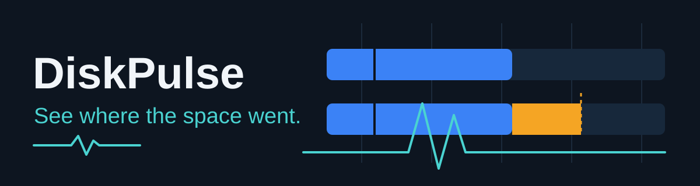
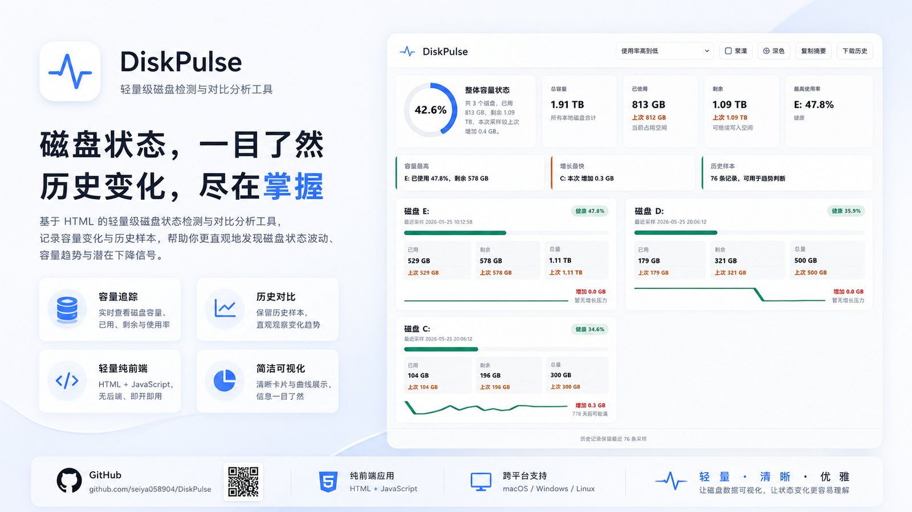

<p align="center">
  
</p>

<p align="center"><sub><em>Illustration of the comparison model, not a screenshot: a real report embeds local paths.</em></sub></p>

A Windows disk dashboard that compares today's scan with trustworthy history, so you can tell real growth from missing data, incomplete scans, or a drive that is no longer the same volume.

**[Download for Windows](https://github.com/seiya058904/DiskPulse/releases/latest)** · [Get started](#get-started) · [What it shows](#what-diskpulse-shows) · [Privacy and optional AI](#privacy-and-optional-ai)

[](https://github.com/seiya058904/DiskPulse/actions/workflows/ci.yml)

Latest release: [v1.5.2](https://github.com/seiya058904/DiskPulse/releases/tag/v1.5.2). Scans and reports run locally and offline by default. The generated dashboard text is in Simplified Chinese; this README is in English.

## What DiskPulse Shows

- **Capacity at a glance.** Fixed drives with total and available space and utilization, without digging through folders by hand.
- **What changed.** Growth and released space across each drive root and its first two directory levels, compared with a valid earlier scan.
- **History and trends.** Eligible earlier scans are compared, and estimates are shown in the context of the data actually available.
- **Honest evidence.** Complete, partial, unavailable, and non-comparable observations are kept apart. An unknown change is never shown as `0`, and a reused drive letter cannot silently turn a different volume into the old one.
- **Incomplete scans are labeled.** The scanner excludes reparse points such as junctions and symbolic links, and the report marks excluded or inaccessible areas instead of pretending they were scanned. An incomplete scan does not overwrite a valid complete baseline.

> [!NOTE]
> Your first scan is a starting point, not a change report. DiskPulse needs a previous, comparable baseline before it can explain what grew or shrank.

## Get Started

**Requirements:** Windows with Windows PowerShell 5.1 or newer. The installed application does not need Node.js, Python, or an online service.

1. **Install.** Download the installer from [GitHub Releases](https://github.com/seiya058904/DiskPulse/releases/latest): [DiskPulse-Setup-1.5.2.exe](https://github.com/seiya058904/DiskPulse/releases/download/v1.5.2/DiskPulse-Setup-1.5.2.exe), with its [SHA-256 file](https://github.com/seiya058904/DiskPulse/releases/download/v1.5.2/DiskPulse-Setup-1.5.2.sha256).
2. **Run a scan.** Launch DiskPulse and start the disk scan. It collects drive and directory-size metadata, then opens a generated local HTML dashboard in your browser.
3. **Compare over time.** Scan again after your storage changes, then use the dashboard to inspect directory growth, freed space, and scan quality before drawing conclusions.

From a source checkout, [`DiskPulse.vbs`](DiskPulse.vbs) launches a scan with no console window, and [`check.bat`](check.bat) runs it with console progress.

## Privacy and Optional AI

DiskPulse is a reporting tool, not a disk cleaner. It reads drive and directory-size metadata only, never file contents, and it never deletes anything.

| By default | Only if you opt in |
| --- | --- |
| Scan fixed-drive and directory-size metadata | Send a sanitized summary to a configured AI endpoint |
| Save local scan history and reports | Request a supplementary natural-language explanation |
| Show unknown or incomplete results as such | Configure or remove your AI settings |

The AI feature is off until you enable and configure it. You can also copy the analysis data from the dashboard and ask an AI service yourself.

- Run [`configure-ai.bat`](configure-ai.bat) from a source checkout to configure, disable, or remove AI settings.
- A configured API key is protected with Windows DPAPI for the current user and is not written into generated reports.
- Remote AI endpoints must use HTTPS (loopback addresses are the exception), and HTTP redirects are rejected.
- AI-bound summaries sanitize user-directory paths. **Local reports can still contain real local paths**, so review a report before sharing it.
- If the AI provider is unavailable, the local report is still generated.

## Data and Upgrades

History and reports are stored under:

```text
%LOCALAPPDATA%\DiskPulse\data\runtime
```

Existing data is meant to survive ordinary upgrades and uninstall, so avoid deleting that directory if you want to keep your history.

> [!IMPORTANT]
> If an older installation has `migration-initialized.json` but its ledger is missing, migration stops to protect historical state. Preserve the data and the original sources, and recover the original ledger after confirming ownership. Do not delete the marker or restart imports just because the runtime directory looks empty.

## Development

DiskPulse is PowerShell, a C# directory scanner, and a browser-rendered HTML, CSS, and JavaScript report. The editable sources are in [`src/`](src/). [`check.bat`](check.bat) is a generated runtime artifact, so change `src/` and regenerate it rather than editing it directly.

Run these from the repository root in Windows PowerShell:

```powershell
# Regenerate the runtime after changing the canonical source
powershell.exe -NoProfile -ExecutionPolicy Bypass -File scripts/build-check.ps1

# Repository verification
powershell.exe -NoProfile -ExecutionPolicy Bypass -File scripts/verify.ps1

# Also build the NSIS installer, when NSIS is available
powershell.exe -NoProfile -ExecutionPolicy Bypass -File scripts/verify.ps1 -IncludeInstaller
```

Installer packaging lives in [`build-installer.ps1`](build-installer.ps1) and [`installer/`](installer/). [`tests/browser/Invoke-DiskPulseBrowserQA.ps1`](tests/browser/Invoke-DiskPulseBrowserQA.ps1) is an extended browser check, not a claim that every browser has been tested. Other entry points are [`check-profile.bat`](check-profile.bat) for profiling and [`configure-ai.bat`](configure-ai.bat) for AI settings.

Further reading: [product principles](PRODUCT.md), [dashboard design](DESIGN.md), and [repository guidelines](AGENTS.md).

## Concept Art

Concept art made for this project. It is an illustration, not a screenshot, and details may differ from the shipped interface.



## License

The repository does not currently include a license file, so no open-source license is granted. Contact the repository owner before redistributing or reusing the code.
